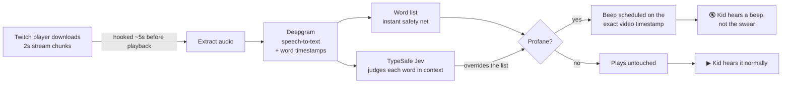
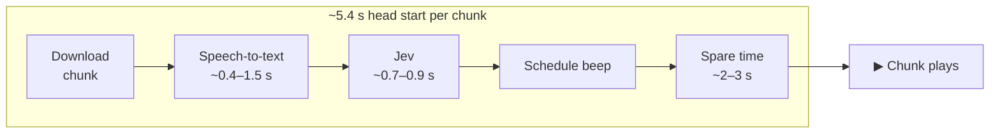

# 🎧 Earmuffs

**Kids watch streamers. Streamers swear. Earmuffs beeps it out — live.**

Earmuffs is a Chrome extension that removes profanity from **Twitch live streams** before your kid hears it: swear words in the streamer's voice get **beeped**, and swears in chat get **masked** (`****`). It decides **in context**, not with a dumb word list — "kick his ass" gets beeped, "I have class tomorrow" and "Dick Grayson" don't.

> Existing tools read captions (live streams don't have them) and match word lists. Earmuffs listens to the actual stream audio, a few seconds ahead of you.

---

## How it works

The trick is **time**. Twitch's player buffers the stream ahead of what you're watching. Earmuffs reads each chunk as it downloads, so it has a head start to transcribe, classify, and line up the beep before the word is played.

## Results

| What we measured | Result |
|---|---|
| Stream chunks captured before playback | 85 / 85 |
| Head start (with low-latency mode neutralised) | **~5.4 s** |
| Beep timing accuracy (chunk → playback mapping) | **~5 ms** |
| Accuracy on the context test set — word list | 13 / 16 |
| Accuracy on the context test set — **Jev** | **16 / 16** |
| Jev latency (median) | **~0.7–0.9 s** |

The three cases a word list gets wrong — and Jev gets right:

| Sentence | Word list | Jev |
|---|---|---|
| "you son of a **b**—" | ❌ misses it | ✅ beeps |
| "I'm reading **Dick** Grayson comics" | ❌ beeps | ✅ leaves it |
| "the rooster, a **cock**, crowed at dawn" | ❌ beeps | ✅ leaves it |

## What gets filtered

- **Blocked:** moderate and severe profanity (f-word, shit, ass, bitch, dick, …) including disguised forms like `f***`, `fvck`, `sh1t`, `f u c k`.
- **Allowed:** mild words (damn, hell, crap), insults that aren't swears (stupid), and normal words that only look like swears (class, assassin, cocktail, Scunthorpe).

## Repo layout

| Path | What's in it |
|---|---|
| [`chrome-extension/`](chrome-extension/) | The extension — **start here** ([README](chrome-extension/README.md)) |
| [`landing/`](landing/) | Marketing landing page (Vite + React) ([README](landing/README.md)) |
| [`plan.md`](plan.md) | Design plan and the decisions behind it |
| [`checklist.md`](checklist.md) | Implementation checklist with what's built and verified |

## Quick start

1. Get API keys: [Deepgram](https://console.deepgram.com) (speech-to-text) and [TypeSafe](https://docs.typesafe.ai) (Jev).
2. Copy `chrome-extension/.env.example` to `chrome-extension/.env` and paste the keys.
3. In Chrome: `chrome://extensions` → **Developer mode** → **Load unpacked** → pick `chrome-extension/`.
4. Open a live Twitch channel and click the page once. The badge on the player turns to **🎧 Earmuffs on**.

Full setup, architecture, and troubleshooting: [`chrome-extension/README.md`](chrome-extension/README.md).

## Status

Hackathon build. Verified live on Twitch: audio beeps, chat masking, on-player badge, popup stats and on/off toggle.

**Not yet (future scope):** parental PIN and uninstall protection, YouTube Live / Kick, VODs, 7TV chat, on-device speech-to-text, and more categories (slurs, sexual content, bullying).
