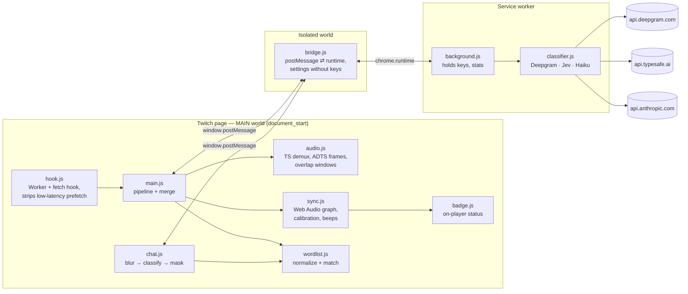
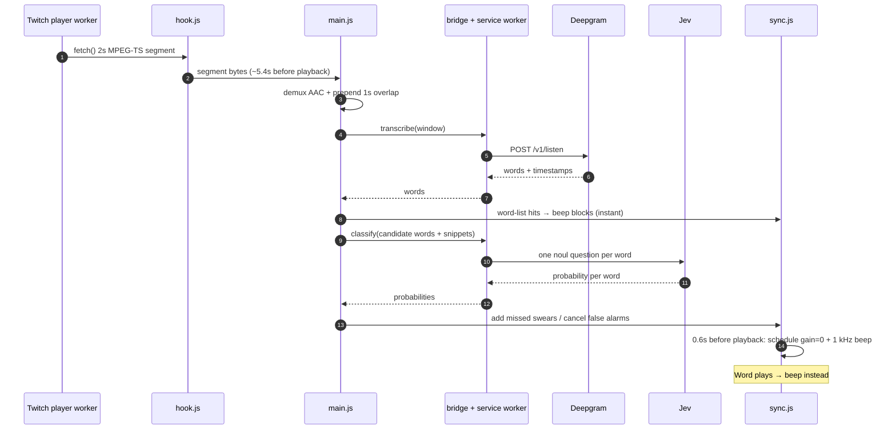
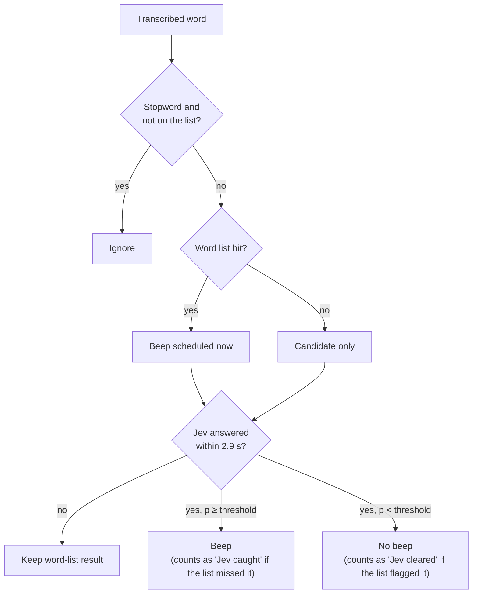
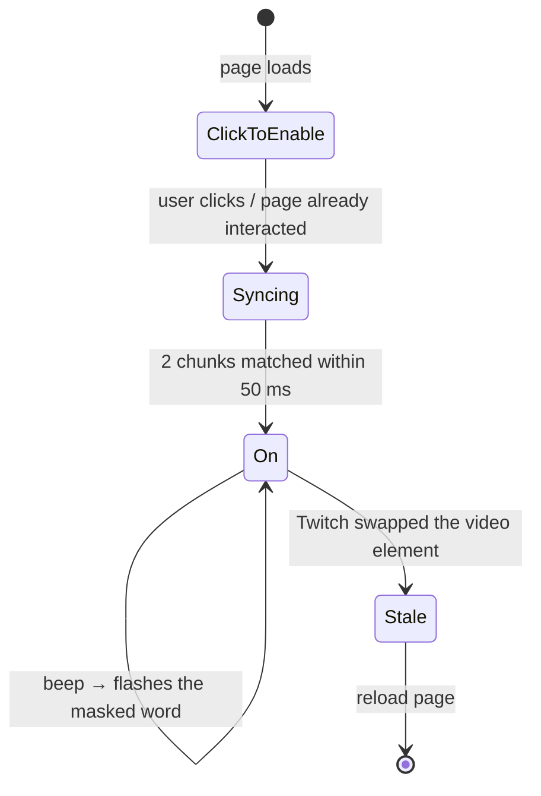

# StreamSafe — Chrome extension

Manifest V3 extension that beeps profanity in **Twitch live** audio and masks it in chat. Plain JavaScript, no build step.

## Setup

1. **Keys.** Copy `.env.example` to `.env` and fill in:
   ```
   DEEPGRAM_API_KEY=...    # speech-to-text (required)
   TYPESAFE_API_KEY=...    # Jev classifier (recommended)
   ANTHROPIC_API_KEY=...   # Claude Haiku fallback (optional)
   ```
   `.env` is gitignored. The extension copies these into its settings on install/reload, but only into empty fields — keys typed in the popup win. You can also just paste them in the popup.
2. **Load it.** `chrome://extensions` → **Developer mode** → **Load unpacked** → this folder.
3. **Use a profile without 7TV** — 7TV replaces Twitch's chat, which the chat filter doesn't support.
4. **Watch.** Open a live channel and click the page once (browsers only allow audio processing after a user gesture). The badge goes *click to enable* → *syncing…* → **🛡 StreamSafe on** in about 10 s.

## Architecture

Three Chrome contexts, because each can do something the others can't:



- **MAIN world** is the only place that can patch Twitch's `Worker`/`fetch` and reach the `<video>` element, but it can't use `chrome.*` APIs.
- **The service worker** makes all network calls: Twitch's CSP would block them from the page, and the keys never enter the page.
- **The bridge** relays requests and pushes settings to the page — without the keys.

## Life of a chunk



### Key ideas

| Problem | Solution | Where |
|---|---|---|
| Need audio *before* it plays | Wrap every Web Worker so its `fetch()` reports media segments as they download | `hook.js` |
| Low-latency mode plays chunks while they download (head start −1.25 s) | Strip `#EXT-X-TWITCH-PREFETCH` from playlists → player falls back to normal latency (head start ~5.4 s) | `hook.js` |
| Words cut at chunk boundaries | Each STT window = last 1 s of the previous chunk + this chunk; a window *owns* words starting in `[segStart−0.5, segEnd−0.5)` | `audio.js` `buildWindow` |
| Map chunk timestamps to playback time | Cross-correlate each chunk's loudness envelope with what the player actually outputs → `offset = currentTime − PTS` (stable to ~5 ms) | `sync.js` |
| Classifier can't locate words | Code picks candidate words; Jev answers one yes/no per word, identified by a snippet like `what the >>fuck<< was` | `main.js`, `classifier.js` |
| API slow or down | Word list decides instantly; Jev overrides only if it answers in time (fail-open) | `main.js`, `chat.js` |

## Decision flow per word



Chat follows the same rules, but only messages with *suspicious* tokens are blurred and checked (a list hit, a masked form like `f***`, or a swear root inside a word like "class"). Clean messages are never delayed.

## Badge states



## Files

| File | Role |
|---|---|
| `manifest.json` | MV3 manifest: MAIN-world scripts in load order, isolated `bridge.js`, module service worker |
| `util.js` | Shared `window.__ss` namespace, RPC to the bridge, byte/base64 helpers |
| `hook.js` | Worker + fetch interception, prefetch stripping |
| `wordlist.js` | `normalize` (leetspeak, homoglyphs, repeats), `isProfane`, `isSuspicious`, stopwords |
| `audio.js` | MPEG-TS demux, ADTS framing/decoding, overlapping STT windows |
| `sync.js` | AudioContext graph, offset calibration, beep scheduler |
| `main.js` | Audio pipeline, word-list + Jev merge, per-chunk logs |
| `chat.js` | Chat observer, batching, masking |
| `badge.js` | Status badge over the player |
| `bridge.js` | Isolated-world relay; never exposes keys to the page |
| `background.js` | Service worker: keys, API calls, stats, `.env` import |
| `classifier.js` | Deepgram, Jev and Haiku clients (shared with the bench) |
| `popup.html` / `popup.js` | Keys, classifier, threshold, on/off, stats |
| `popup.css` | Popup styles — paper, ink borders, stickers (matches `landing/`) |
| `page.css` | In-page styles for the badge, beep pop and chat masks; injected via the manifest so Twitch's CSP can't block it |
| `fonts/` | Inter, Instrument Serif, Caveat (bundled, OFL) — same type as the landing page |
| `icons/` | Toolbar/extension icons rendered from the landing page's shield logo |

## Development

```bash
npm run check   # syntax, word list, TS demux + overlap windows (needs ffmpeg), prefetch stripping
npm run bench   # word list vs Jev vs Haiku on 16 context cases (reads keys from .env)
```

**Debugging on Twitch**

- Page console: one `[streamsafe] chunk {stt, classifier, slack, words, beep, changes}` line per chunk. `slack` must stay positive — it's the time left before that chunk plays. `changes` shows Jev overrides (`+` added, `-` cleared).
- Service worker console (`chrome://extensions` → StreamSafe → *service worker*): every Deepgram/Jev call with its latency or error.
- Popup: counters and the last error.

## Settings

| Setting | Default | Notes |
|---|---|---|
| Classifier | Jev | Haiku is a fallback; it was ~5.5 s per call in the bench, too slow for live use |
| Threshold | 0.5 | Probability at or above which a word is treated as profanity |
| On/off | on | Off = nothing scheduled, chat untouched (the stream hook stays installed) |

## Limitations

- Twitch **live** only; native Twitch chat only (no 7TV/BTTV).
- The first ~8 s after enabling are unfiltered while the timeline syncs.
- The stream plays ~5 s further behind live (the head start is the point).
- Ad breaks or quality switches can trigger a short re-sync.
- A Twitch page script could send requests through the bridge and spend your API quota — fine for a demo, not for a public release.
